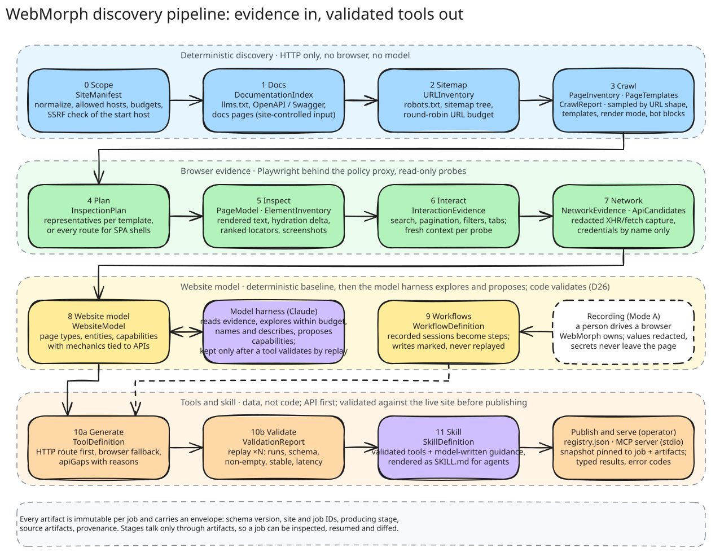
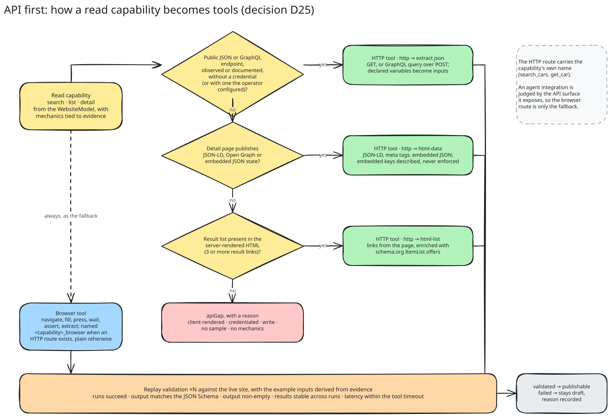
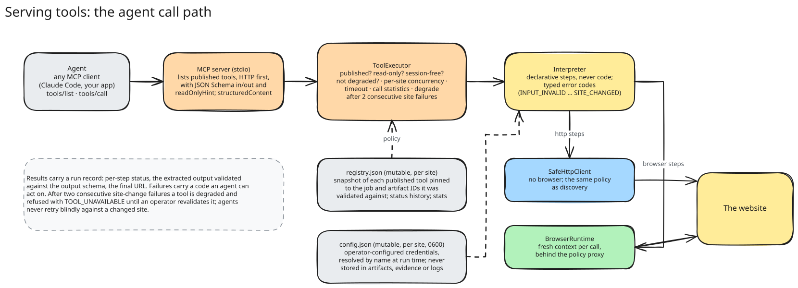
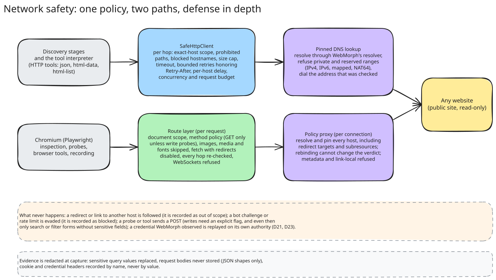

<h1 align="center">WebMorph</h1>

<p align="center">
  Turn any website into validated, read-only tools and skills that AI agents can call without a browser.
</p>

<p align="center">
  <a href="https://github.com/AbdelhafzDev/webmorph/actions/workflows/ci.yml"></a>
  
  
  
  <a href="LICENSE"></a>
</p>

WebMorph is an LLM harness that turns any website into tools and skills. Deterministic stages collect evidence about a site (robots and sitemaps, a sampled crawl, browser inspection, interaction probes, redacted network capture, documentation). A model then does the understanding: it reads that evidence, explores the site within a budget, names things in the site's own vocabulary, and proposes capabilities with their mechanics. For every proposal the harness generates the tool and replays it against the live site, and keeps only what validates. An operator publishes the validated tools over the Model Context Protocol, and a skill generator composes them with model-written guidance into a `SKILL.md` an agent loads as one unit.

Three things stay in code whatever the model says: the safety policy (scope, SSRF, read-only methods, robots, credentials by reference), the evidence record, and the replay verdict. Tools are data, not code; HTTP tools come first and browser tools are the fallback; nothing the model proposes exists until a replay proved it.

## How it works

<picture>
  <source media="(prefers-color-scheme: dark)" srcset="docs/diagrams/pipeline.dark.svg">
  
</picture>

Four groups of stages. Each stage reads earlier artifacts and writes its own, immutable per job, so a run can be inspected, resumed and diffed. The model takes part in three of them: it chooses which pages to inspect (stage 4), it drives the website model (stage 8), and it writes the skill's guidance (stage 11). The full stage-by-stage description is in [docs/architecture.md](docs/architecture.md).

## What you get

Capabilities come in three layers. **Browser primitives** (navigate, fill, click, wait, extract) are implemented once by the runtime. **Website-specific tools** (`search_cars`, `get_car`) are discovered from the site, typed, validated and published. **Skills** compose a site's validated tools with guidance into a reusable bundle an agent loads as one unit.

An agent integration is judged by the API surface it exposes, so WebMorph generates tools API first: the HTTP route carries the capability's name, the browser route is the `_browser` fallback, and capabilities with no HTTP route are reported as gaps with a reason.

<picture>
  <source media="(prefers-color-scheme: dark)" srcset="docs/diagrams/api-first.dark.svg">
  
</picture>

A tool is a declarative program with a JSON Schema contract, preconditions, error cases, example inputs and evidence pointing back at the artifacts that justify it:

```jsonc
{
  "name": "search_products",
  "transport": "http",
  "sideEffectClass": "read",
  "inputSchema": { "type": "object", "properties": { "query": { "type": "string", "minLength": 1 } }, "required": ["query"] },
  "program": [
    { "op": "http", "method": "GET", "url": "https://shop.example/api/products", "query": { "q": "query" }, "accept": "application/json" },
    { "op": "extract", "extractor": { "kind": "json", "into": "data" } }
  ],
  "errorCases": [{ "code": "SITE_CHANGED", "when": "an assertion about the page failed; the site may have changed" }],
  "evidence": [{ "artifactType": "ApiCandidates", "refId": "api-3f9c…", "note": "search request observed during the search probe" }]
}
```

Validation replays every tool against the live site with its example inputs and requires five checks to pass: runs succeed, output matches the schema, output is non-empty, results are stable across runs, latency is within the tool's timeout. On a 60,000-URL car marketplace this produced 25 tools, 11 of them pure HTTP, 24 validated; listings answer in under a second where the browser fallback takes three to five ([docs/comparisons/syarah.md](docs/comparisons/syarah.md)).

## Quick start

Requires Node 20+ and pnpm. Browser stages need Chromium.

```bash
pnpm install
pnpm exec playwright install chromium --only-shell
pnpm build
cp .env.example .env            # put ANTHROPIC_API_KEY or OPENAI_API_KEY in .env (gitignored); the CLI loads it at startup
node dist/cli.js discover https://example.com --max-pages 30
```

Without a key the pipeline still runs end to end on its deterministic path and records that the model was unavailable.

Then review, publish and serve:

```bash
node dist/cli.js tools <siteId>                   # tools with validation verdicts
node dist/cli.js publish <siteId>                 # publish every validated tool
node dist/cli.js call <siteId> search_products --input '{"query":"shoes"}'
node dist/cli.js serve <siteId>                   # MCP server over stdio
node dist/cli.js studio                           # local review UI at http://127.0.0.1:4848
```

MCP client configuration, for example in Claude Code:

```json
{ "mcpServers": { "webmorph-shop": { "command": "node", "args": ["/path/to/webmorph/dist/cli.js", "serve", "<siteId>", "--out", "/path/to/.webmorph"] } } }
```

Artifacts land under `.webmorph/sites/<siteId>/jobs/<jobId>/artifacts/`. Add `--json` to `discover` for a machine-readable summary and `-v` to log every fetched page.

## The model harness

Stage 8 starts from the deterministic model and hands it to the model as data, with tools of its own: read an evidence record, read a page or JSON endpoint over the policed HTTP client, open a page in the policed browser, add or rename an entity, revise or drop a capability, record the site's purpose and hypotheses, and propose a capability with its mechanics and the evidence it rests on. Every proposal is generated into tools and replayed against the live site at once; it is kept only when a tool validates, and the model is told why otherwise so it can fix the mechanics. A proposal must cover an entity or a repeatable query (a search, a listing, a detail page family, an endpoint with inputs); one fixed page with no inputs is refused unless it is a listing that returns several results. Budgets bound the loop: turns, HTTP reads, browser inspections, proposals and tokens (`--agent-turns`, `--agent-fetches`, `--agent-inspections`, `--agent-proposals`); two turns before the end the model is reminded to record the site summary and finish, and if it never does, a deterministic purpose sentence is written from what it kept. Entities nothing references are dropped after the loop. Every tool call, proposal, verdict and revision is recorded in the `WebsiteModel` artifact under `agent`.

What the model cannot do: widen the scope, send a write, replay a credential it saw, or cite evidence that does not exist. An observed endpoint whose requests carried an authorization header stays off limits without an operator-configured credential; one flagged only by a session-like cookie name (a chat widget's `sessionId`) may be proposed, because the generated tool sends no cookies and the replay decides whether the endpoint is public. Those checks are code, and they are the same clients the deterministic stages use. Without a model (`--no-model`), or when the model errs or declines, every stage keeps its deterministic result and records why; a run never fails because the model did. `--no-harness` keeps the older one-shot enrichment.

The model is Claude through the Anthropic SDK (`claude-opus-5-5` by default) or an OpenAI model through the OpenAI SDK (`gpt-5.5` by default); `--model-id` picks the model and `--model-provider` the provider, which is otherwise inferred from the model id or from which key is set (`ANTHROPIC_API_KEY` or an `ant auth login` profile; `OPENAI_API_KEY`). Both clients speak the same harness protocol (strict tools, tool calls, tool results), so the loop and its guardrails are identical. Page content reaches the model only as JSON data labelled as such, and model text that reads like an instruction to a downstream agent is dropped.

## Skill generator

A tool answers one question; a skill teaches an agent a site. Stage 11 composes a site's validated tools into a `SkillDefinition`: a `SKILL.md`-style guide with what the site offers, which tool to call for which intent, how one tool's output feeds another (a result URL into the detail tool), what each error code means, worked examples taken from the validation runs, and the MCP configuration that serves the tools. The model writes the guidance; every statement is grounded by code: it may name only validated tools and real inputs, the examples are computed from validation output rather than written, instruction-like text is dropped, and a URL survives only when it is on the site's own domain. A hand-off that lists several inputs (`section, slug`) is kept as one hand-off per input. Without a model the skill is rendered from a template.

```bash
node dist/cli.js skill <siteId>        # writes SKILL.md, tools.json and mcp.json under .webmorph/sites/<siteId>/skills/<name>/
```

## Serving tools to agents

<picture>
  <source media="(prefers-color-scheme: dark)" srcset="docs/diagrams/runtime.dark.svg">
  
</picture>

Only published, read-only, session-free tools run. Calls are bounded by a per-site concurrency limit and the tool's timeout. After two consecutive failures that implicate the site rather than the caller, a tool is degraded and refused until an operator revalidates it, so agents never retry blindly against a changed site. Results come back as `structuredContent`; failures carry one of the typed error codes (`INPUT_INVALID`, `OUT_OF_SCOPE`, `LOCATOR_MISSING`, `NOT_FOUND`, `SITE_CHANGED`, `OUTPUT_INVALID`, `BLOCKED`, `TIMEOUT`, `RUNTIME_ERROR`, `PERMISSION_DENIED`).

## Safety model

<picture>
  <source media="(prefers-color-scheme: dark)" srcset="docs/diagrams/safety.dark.svg">
  
</picture>

- **Scope is exact hostnames.** Redirects and links to other hosts are recorded and never followed.
- **SSRF defense in depth.** Blocked hostnames, private and reserved IPv4 and IPv6 ranges (including mapped and NAT64 forms), DNS resolve-and-check before the first request, a pinned lookup so the address that was checked is the one dialed, and every redirect hop re-checked. The browser gets the same policy twice: a local policy proxy per connection and a route layer per request.
- **Read-only by construction.** Probes and tools never send a write without an explicit operator flag, and even then only search or filter forms without sensitive fields. Consequential controls (buy, delete, sign in, subscribe, accept cookies) are inventoried, never activated.
- **Bot protection is detected, never evaded.** Challenge and rate-limit pages are marked `blocked`.
- **Evidence is redacted at capture.** Sensitive query values replaced, request bodies never stored, cookie and credential headers recorded by name only.
- **Credentials are never captured.** A keyed public API becomes an HTTP tool only when the operator configures the key for that host and header; the value lives in one owner-only file and is resolved by name at run time. See [docs/architecture.md#keyed-public-apis](docs/architecture.md#keyed-public-apis) and decision D23. A cookie name alone is not a credential: an endpoint flagged only by a session-like cookie gets a tool that sends no cookies, and the replay decides (D21).
- **Polite by default.** Identifying User-Agent, per-host delay, robots.txt honored, `Retry-After` respected.
- **The model proposes; code verifies.** The model may read evidence, explore within budget and propose capabilities, but a capability exists only after a generated tool validated by replay, every proposal must cite evidence that exists, and a skill may name only validated tools. Page content reaches the model only as data, and instruction-like model text is dropped.

## CLI

| Command | Purpose |
|---|---|
| `discover <url>` | Run the pipeline. Budgets: `--max-pages`, `--max-depth`, `--delay-ms`, `--concurrency`, `--inspect-pages`, `--max-probes`, `--validation-runs`. Model: `--model-id`, `--model-provider anthropic|openai`, `--no-model`, `--no-harness`, `--agent-turns`, `--agent-fetches`, `--agent-inspections`, `--agent-proposals`. Scope: `--allow-host`, `--ignore-robots` (sites you own), `--allow-private` (test fixtures). Stages: `--no-browser`, `--no-interactions`, `--no-validate`, `--resume <jobId>`. Credentials: `--api-credential '[name@]host:header=value'`, `--api-credentials-file <json>`. |
| `tools <siteId>` | Generated tools with validation verdict and registry status. |
| `publish <siteId> [names...]` | Approve validated tools into the per-site registry (`--force` for unvalidated, `--job` to choose a job). |
| `call <siteId> <name> --input <json>` | Call a published tool through the executor. |
| `run-tool <siteId> <name> --input <json>` | Run any generated tool from a job, published or not. |
| `disable`, `enable`, `revalidate` | Lifecycle of published tools. |
| `serve <siteId>` | MCP server over stdio. |
| `skill <siteId>` | Export the skill: `SKILL.md`, the validated tool contracts and the MCP configuration. |
| `credentials list\|set\|remove <siteId>` | Operator-configured credentials for keyed public APIs. Never prints values. |
| `record <siteOrUrl>`, `recordings <siteId>` | Record a workflow by hand in a browser WebMorph owns; list recordings. |
| `studio` | Local review UI over the artifact store. |
| `schemas export [dir]` | JSON Schema for every artifact type. |

## Artifacts

| Artifact | Stage | Contents |
|---|---|---|
| `SiteManifest` | 0 | Normalized start URL, allowed hosts, budgets, prohibited actions, resolved addresses, credential references |
| `DocumentationIndex` | 1 | `llms.txt`, OpenAPI and Swagger operations with parameters, auth and side-effect class, documentation pages |
| `URLInventory` | 2 | robots.txt verdicts, sitemap tree, every discovered URL with its sources, route candidates |
| `PageInventory`, `PageTemplates`, `CrawlReport` | 3 | Per-page facts, pages grouped into classified templates, budgets and bot-protection signals |
| `InspectionPlan` | 4 | Which pages get a browser session and why, chosen by the model among the heuristic candidates |
| `PageModel`, `ElementInventory` | 5 | Rendered page state, dialogs, screenshots; interactive elements with ranked locators |
| `InteractionEvidence`, `StateTransition` | 6 | Probes with before and after state; navigations and in-page changes |
| `NetworkEvidence`, `ApiCandidates` | 7 | Redacted traffic; observed endpoints matched against documentation |
| `WebsiteModel` | 8 | Page types, entities, capabilities with mechanics; facts citing evidence, hypotheses citing facts; the harness record |
| `WorkflowDefinition` | 9 | Recorded sessions as replayable steps |
| `ToolDefinition`, `ValidationReport` | 10 | Tools as declarative programs with `apiGaps`; replay verdicts and reasons |
| `SkillDefinition` | 11 | The site's validated tools composed with grounded guidance, rendered as `SKILL.md` |

Every artifact carries a common envelope (schema version, site and job IDs, producing stage, source artifacts, provenance) and every type is a Zod schema exportable to JSON Schema.

## Documentation

- [docs/architecture.md](docs/architecture.md): stages, tool generation, safety, runtime, store layout.
- [docs/decisions.md](docs/decisions.md): twenty-six numbered architecture decisions and the reasons behind them.
- [docs/roadmap.md](docs/roadmap.md): the seven delivered phases with their acceptance criteria and known gaps.
- [docs/comparisons/](docs/comparisons/): evaluations against live sites, such as a 60,000-URL bilingual car marketplace.
- [plan.md](plan.md) and [plan-review.md](plan-review.md): the original product plan and its review.
- Diagrams: Excalidraw sources under [docs/diagrams/](docs/diagrams/), generated from [scripts/diagrams/scenes.mjs](scripts/diagrams/scenes.mjs) with `pnpm diagrams`.

## Development

```bash
pnpm test          # unit tests plus end-to-end runs against a local fixture site
pnpm typecheck
pnpm build
pnpm diagrams      # regenerate docs/diagrams/* with Excalidraw's exporter in headless Chromium
```

The fixture site in `test/fixtures/server.ts` exercises sitemaps (index, gzip, text), robots rules, redirect loops, out-of-scope and private redirects, oversized and gzip-bomb responses, retryable errors, SPA shells, bot challenges, GraphQL queries and mutations, a keyed JSON API, embedded page JSON, and a mix of page templates. Every safety property has a test that tries to violate it.

```
src/
  schemas/    Zod artifact contracts (source of truth, exported to JSON Schema)
  core/       artifact store, job runner, IDs, errors
  net/        URL normalization, SSRF guard, scope policy, rate limiting, safe HTTP client, redaction
  html/       HTML fact extraction, render-mode probe, templates, bot-block detection, page data
  browser/    Playwright runtime behind the policy proxy, inspection, probes, locators
  docs/       llms.txt and OpenAPI parsing
  model/      deterministic website model, naming, Claude enrichment
  tools/      tool generation, sampling, the interpreter
  stages/     stage0-scope … stage10-validate
  registry/   published-tool registry
  adapter/    executor and MCP server
  record/     recorder and in-page instrumentation
  studio/     local review UI
test/         vitest suites and the fixture site
docs/         architecture, decisions, roadmap, comparisons, diagrams
scripts/      diagram generator
```

## Status

All planned phases are implemented and tested against the fixture site and live sites, including the model harness (decision D26) and the skill generator. The harness has run live with `gpt-5.5` against the fixture site: 11 turns, 27 tool calls, 3 capabilities proposed and all 3 validated by replay (a GraphQL search the heuristics had missed, plus a documentation entity with its list and detail tools), 193k input tokens of which 166k were cache reads. A live run against a real site is the next step, followed by a benchmark harness over a fixed site set and scheduled revalidation to report replay stability over time. See [docs/roadmap.md](docs/roadmap.md).

## License

[MIT](LICENSE).
