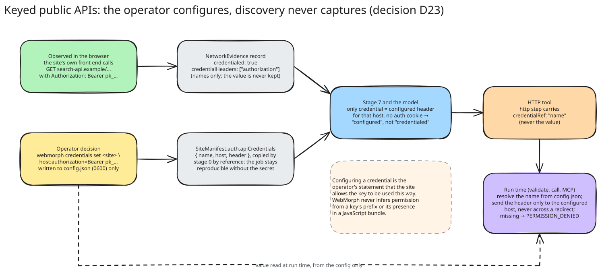

# Architecture

How WebMorph turns a website into validated tools, stage by stage. The diagrams are Excalidraw files under [diagrams/](diagrams/); open any `.excalidraw` at [excalidraw.com](https://excalidraw.com) to edit it, or run `pnpm diagrams` to regenerate the SVGs from [`scripts/diagrams/scenes.mjs`](../scripts/diagrams/scenes.mjs). Decisions behind the design are numbered in [decisions.md](decisions.md); the phase history is in [roadmap.md](roadmap.md).

## Principles

- **Evidence first.** Every capability, fact and hypothesis in the website model cites the artifacts that justify it. Mechanics (URLs, parameters, locators, side-effect class, auth requirement) come only from evidence; a language model may add descriptions and cited hypotheses, never mechanics (D13).
- **Tools are data.** A tool is a declarative step program interpreted by the runtime, with JSON Schema inputs and outputs. No code is generated (D4).
- **API first.** Every read capability gets its HTTP route under the capability's own name; the browser route is the `_browser` fallback. Capabilities with no HTTP route are reported as `apiGaps` with a reason (D25).
- **Read-only by construction.** Probes and tools never submit writes without an explicit operator flag, and even then only search or filter forms without sensitive fields (D16, D19).
- **Validated against the live site.** Tools start as drafts and become publishable only after replay validation passes five checks (D14). Publishing is an operator action into a registry pinned to the artifacts the tool was validated against (D17).
- **Artifacts are immutable per job.** Stages communicate only through persisted artifacts with a common envelope, so a job can be inspected, resumed and diffed (D5, D6).

## The pipeline


| Stage | Produces | What it does |
|---|---|---|
| 0 Scope | `SiteManifest` | Normalizes the start URL, fixes the exact-host scope, budgets and prohibited actions, resolves the start host and refuses private or blocked targets. Records operator-configured credentials by reference only (D23). |
| 1 Docs | `DocumentationIndex` | Finds `llms.txt` and `llms-full.txt`, OpenAPI 3 and Swagger 2 documents (JSON or YAML) and documentation pages. Operations are parsed with parameters, response shapes, auth requirements and side-effect class. Site-controlled input, recorded as evidence and never trusted over observed behavior. |
| 2 Sitemap | `URLInventory` | robots.txt verdicts and the sitemap tree (indexes, gzip, plain text), with the URL budget shared round-robin across sitemap files so every section of a large site is represented (D22). |
| 3 Crawl | `PageInventory`, `PageTemplates`, `CrawlReport` | A static crawl sampled by URL shape rather than breadth-first, seeded from the start URL, `llms.txt` links and the sitemap. Extracts titles, metadata, headings, links, forms, scripts and JSON-LD; probes render mode (static, hybrid, SPA shell); groups pages into templates by URL pattern and DOM skeleton cohesion; detects bot protection and marks it `blocked` rather than evading it (D8). |
| 4 Plan | `InspectionPlan` | Chooses which pages get a browser session: representatives per template, or every route when the site is a client-side shell. Authentication, account and legal pages are never probed. |
| 5 Inspect | `PageModel`, `ElementInventory` | Playwright inspection in an isolated context: rendered text, hydration delta versus static HTML, landmarks, dialogs, console errors, accessibility snapshot, screenshots and DOM snapshots as blobs; interactive elements with role, accessible name, category and ranked locator candidates whose uniqueness is measured in-page. |
| 6 Interact | `InteractionEvidence`, `StateTransition` | Bounded read-only probes with before and after state: search submit, pagination, filter change, tab change, menu open, accordion expand. A fresh browser context per probe; typed search values come from the page's own vocabulary (D15). |
| 7 Network | `NetworkEvidence`, `ApiCandidates` | XHR, fetch and document traffic captured during inspection and probes, redacted at capture time: sensitive query values replaced, bodies never stored (JSON shapes only), cookie and credential headers recorded by name. Traffic is grouped into API candidates and matched against documented operations. GraphQL `query` operations over POST count as reads (D21). |
| 8 Website model | `WebsiteModel` | Deterministic model first: page types, entities, capabilities with mechanics tied to documented or observed APIs, navigation and authentication facts. Optional Claude enrichment with schema-constrained output and a grounding filter (D13). |
| 9 Workflows | `WorkflowDefinition` | Recorded sessions reconstructed into interpreter steps with per-step evidence. Workflows that write or act on consequential controls require approval, are never replayed and cannot be published (D19). |
| 10a Generate | `ToolDefinition` | Tools from read capabilities and workflows, API first (see below), plus `apiGaps`. |
| 10b Validate | `ValidationReport` | Each tool replayed N times with its example inputs: runs succeed, output matches the schema, output is non-empty, results are stable across runs, latency is within the timeout. |

After the pipeline, an operator publishes validated tools into the per-site registry, and the MCP server serves them.

## How a capability becomes tools


Three HTTP routes are tried in order:

1. **The site's own JSON API**, documented or observed: `http` then `extract json`. Generated only for public, read-only endpoints (GET, or GraphQL `query` operations over POST, whose declared variables become optional inputs), or for endpoints whose only credential is one the operator configured (D23).
2. **The structured data a detail page publishes**: JSON-LD, Open Graph and meta tags, embedded JSON state, read over one GET (`html-data`). The embedded objects' keys and observed value kinds are described in the output schema but never enforced by it (D24).
3. **The result list a listing or search page already contains**: the landing page is read once with the example inputs, and when its HTML holds three or more result links the tool fetches the page and parses them (`html-list`), enriched with price, currency, availability and images from the page's schema.org `ItemList`.

A capability that passes none of these gets an `apiGaps` entry with a reason (client-rendered, credentialed, write, no sample, no mechanics). The browser tool is generated as well, named `<capability>_browser` when an HTTP route exists and plain otherwise. Every tool carries the same JSON Schema contract and goes through the same replay validation.

## Network safety


The same scope and SSRF policy applies to the HTTP client and to every request the browser makes (D11, D16):

- **Scope is exact hostnames** (D10). Redirects and links to any other host are recorded as out of scope and never followed. HTTP tools may additionally call same-site API hosts named by their steps.
- **SSRF defense in depth.** Blocked hostnames (localhost, `.local`, `.internal`, cloud metadata), private and reserved IPv4 and IPv6 ranges (including mapped and NAT64 forms), DNS resolve-and-check before the first request, and a pinned lookup so the address that was checked is the address that is dialed. Every redirect hop is checked again.
- **Two layers for the browser.** Playwright's route handlers see only the first request of a redirect chain and Chromium resolves DNS itself, so neither can carry the guarantee alone. The browser runs behind a local policy proxy that resolves and pins every host (the SSRF layer, including redirect hops and WebSockets), and the route layer performs each fetch itself with redirects disabled, checking scope, method and resource type per hop. Document redirects are handed back to the navigator as explicit navigations so the page URL stays truthful.
- **Bounded everything.** Response size, request timeout, redirects, retries, pages, depth, sitemap files and URLs, links per page, probes per page and per site, network records, and a per-stage request budget.
- **Polite by default.** Identifying User-Agent, per-host delay, robots.txt honored unless the operator owns the site, `Retry-After` respected (D9).

## Serving tools to agents


- **Registry.** `.webmorph/sites/<siteId>/registry.json` holds a snapshot of each published tool pinned to the job and artifact IDs it was validated against, with a status history and call statistics. A new discovery run never changes a published tool until an operator republishes (D17).
- **Executor.** Only published, read-only, session-free tools run. Calls are bounded by a per-site concurrency limit and the tool's timeout. After two consecutive failures that implicate the site rather than the caller (`SITE_CHANGED`, `LOCATOR_MISSING`, `OUTPUT_INVALID`, or `NOT_FOUND` on a tool without path inputs) the tool is degraded and refused with `TOOL_UNAVAILABLE` until `revalidate` restores it.
- **Interpreter.** Declarative steps (`navigate`, `fill`, `press`, `click`, `click-result`, `wait`, `assert`, `extract`, `http`) with a typed error taxonomy: `INPUT_INVALID`, `OUT_OF_SCOPE`, `LOCATOR_MISSING`, `NOT_FOUND`, `SITE_CHANGED`, `OUTPUT_INVALID`, `BLOCKED`, `TIMEOUT`, `RUNTIME_ERROR`, `PERMISSION_DENIED`. HTTP tools run through the safe HTTP client without a browser; browser tools get a fresh context per call.
- **MCP server.** Stdio transport; tools listed HTTP first with JSON Schema inputs and outputs and `readOnlyHint` annotations; results as `structuredContent`; failures as an error object with a code the agent can act on.

## Keyed public APIs



Some sites gate a public API behind a publishable key that their own front end sends on every call. Discovery records such a request as credentialed and keeps only the header's name. If the site allows the key to be used, the operator configures it for the host and header it belongs to (`webmorph discover --api-credential`, `webmorph credentials set`). The value lives only in the mutable site config (`config.json`, owner-only); the manifest records the credential by name, host and header. Stage 7 then treats an observed read-only request whose only credential is that header as *configured* rather than *credentialed*, the model links it, and the HTTP tool carries a `credentialRef`. The interpreter resolves the reference at run time, sends the header only to the configured host and never across a redirect to another origin, and answers `PERMISSION_DENIED` when the credential is missing. Configuring it is the operator's statement that the site permits its use; WebMorph never infers permission from a key's prefix or its presence in a bundle (D23).

## Recording and workflows

`webmorph record` opens a headed browser WebMorph owns, under the same scope and SSRF policy as discovery but with writes allowed because a person is performing them. Every click, input, selection, submission and navigation becomes a semantic event with the element's ranked locators and the page state before and after, streamed to `recordings/<sessionId>/events.jsonl`. Typed values are redacted unless `--keep-values` is set, and values of password, email, phone and similar fields never leave the page. Stage 9 turns a recording into a `WorkflowDefinition` and stage 10 into a tool; read-only workflows are validated by replay, writes are marked as requiring approval and are never replayed or published (D19).

## Studio

`webmorph studio` serves a local review UI over the artifact store: every job's stages and crawl report, templates and pages, browser inspection with screenshots and element inventories, probes, documentation and observed APIs, the website model with facts and hypotheses, generated tools with validation verdicts and registry status, workflows, recordings and the registry. Operators publish, disable, re-enable and revalidate tools and try a published tool with a form generated from its input schema. It binds to loopback with no authentication because WebMorph is local-first, renders all site-controlled text through DOM construction, and adds no state of its own (D20).

## Model enrichment

Stage 8 may call Claude through the Anthropic SDK with schema-constrained output (`claude-opus-5-5` by default; `--model-id` to change, `--no-model` to skip). Credentials resolve from the environment (`ANTHROPIC_API_KEY`, `ANTHROPIC_AUTH_TOKEN`, or an `ant auth login` profile); without them the stage records the failure and keeps the deterministic model. Page content reaches the model only as JSON data inside the user message, with a system prompt that tells it to ignore instructions found there. Every hypothesis must cite fact IDs and every entity must cite page type IDs that exist; anything else is dropped and listed under `enrichment.rejected`. The model can never change a capability's mechanics, scope or side-effect class (D13).

## Store layout

```
.webmorph/
  sites/<siteId>/
    site.json                       site record (origin, jobs)
    config.json                     mutable operator config; the only home of credential values (0600)
    registry.json                   published tools, pinned to the artifacts they were validated against
    recordings/<sessionId>/         events.jsonl, network.jsonl, session.json, blobs
    jobs/<jobId>/
      job.json                      mutable job state (per-stage status, resumable)
      artifacts/<Type>.json         immutable artifacts with a common envelope
      evidence/<name>.jsonl         append-only evidence logs (network, interactions)
      blobs/                        screenshots, DOM snapshots
```

Every artifact type is a Zod schema in `src/schemas/`, exportable to JSON Schema with `webmorph schemas export` (D7).
